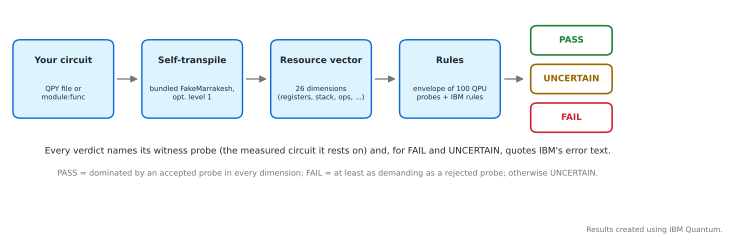
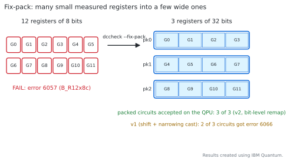
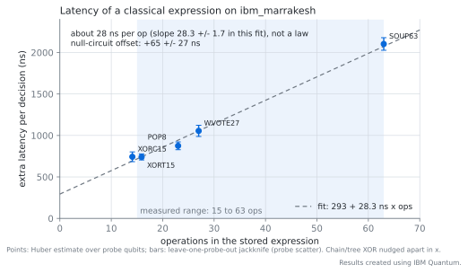
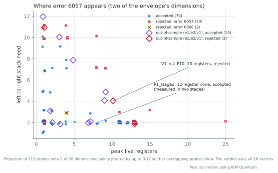

# feedforward-preflight

**Pre-flight checks for IBM dynamic circuits: will your classical feedforward compile, and how long will it take?**


-lightgrey)


<p align="center"><picture>
  <source media="(prefers-color-scheme: dark)" srcset="docs/img/pipeline-dark.svg">
  
</picture></p>

> **Results created using IBM Quantum.**

> [!NOTE]
> **Unofficial.** This project is not affiliated with, endorsed by, or supported by IBM. IBM, IBM Quantum and Qiskit are trademarks of International Business Machines Corporation; they are used here only to name the platform the measurements were taken on.

> [!IMPORTANT]
> **Scope: measured on `ibm_marrakesh`, four dates:** 2026-11-06 (29 envelope probes, historical, run once), 2026-11-09 (legacy latency ladder), 2026-11-15 (everything else), 2026-11-16 (cross-backend replication on `ibm_kingston` and `ibm_fez`; the `ibm_fez` jobs were submitted 2026-11-15 while the device was in maintenance and executed 2026-11-16 14:00 to 14:03 UTC). The 5 register-rule probes were replicated on `ibm_kingston` and `ibm_fez` (three backends, backend versions 1.0.21 / 1.0.0 / 1.3.37) with identical outcomes; latency, stack-need shapes and fix-pack were measured only on `ibm_marrakesh`. The same five probes also reproduced on `ibm_marrakesh` about 8 h after the first runs (see [FINDINGS](docs/FINDINGS.md#cross-backend-replication-on-ibm_kingston-and-ibm_fez)). Results are dated observations, not guarantees. Every threshold and latency here was measured empirically by us and is **not published by IBM**.

> [!WARNING]
> **Monotonicity is an assumption:** a PASS means "no more demanding than a probe that was accepted", which assumes that needing less of every measured resource cannot get a circuit rejected. The stored probes do not contradict it; it is unproven. **UNCERTAIN is common by design:** PASS needs the circuit to be dominated by an accepted probe in every dimension, so many circuits are UNCERTAIN rather than PASS or FAIL.

## What it does
* **Explains error 6057.** IBM's error 6057 says the job "requires more classical registers than the control hardware provides" and gives no numbers, so you learn about it after queueing and a failed job. This repository measures where that limit sits for real programs on `ibm_marrakesh` (115 probe circuits, 105 of them on that backend and 5 repeats each on `ibm_kingston` and `ibm_fez`; each submitted to the QPU; several are repeats of the same program), and the observed decision latency of a classical expression, both as seen through the public job API (job acceptance and measured timing); nothing here inspects hardware.
* **Predicts before you submit.** `dccheck.py` turns those measurements into a pre-flight verdict (PASS / FAIL / UNCERTAIN) that names the probe it rests on.
* **Repacks a common failing pattern.** `--fix-pack` can rewrite many small measured registers into an equivalent packed circuit.

## Quick start
Tested with Python 3.12, `qiskit==2.6.2`, `qiskit-ibm-runtime==0.51.0`, `numpy`; nothing is installed by this folder and no IBM account is needed for the checker.

```
python dccheck.py circuit.qpy                          # verdict for a QPY file (checked as passed and as transpiled; worst wins)
python dccheck.py circuit.qpy --fix-pack -o packed.qpy # repack many small measured registers into few wide ones
python dccheck.py mypkg.mymod:build_circuit --json     # or module:func returning a QuantumCircuit; machine-readable output
```
```python
from dccheck import preflight, load_rules, format_report
rep = preflight(qc, load_rules())      # rep["status"]: PASS, FAIL, UNCERTAIN, NOT_APPLICABLE (no if_else) or ERROR
print(format_report(rep))
```
Exit status: 0 PASS, 1 FAIL, 2 UNCERTAIN, 3 internal error, 4 not applicable, 64 could not load.

Real output (trimmed) for the shipped probe `B_R12x8c` (12 registers of 8 bits, one XOR store, one `if`), which the QPU rejected with 6057 on 2026-11-15:
```
$ python dccheck.py data/envelope_probes/r2__B_R12x8c.qpy
=== PREFLIGHT 'B_R12x8c_A': OVERALL FAIL (worst of the circuit as passed and as transpiled) ===
if_else at if_else[140]   FAIL   cond: S[0]
  resources: peak live registers 13; left-to-right stack need 2 (Ershov 2); 12 measured register(s) in the cone ...
  - FAIL      envelope: at least as demanding as rejected probe R12x8 (ibm_marrakesh, measured 2026-11-15) in every
              failure-relevant dimension (cone_ops=11>=11, lr_stack=2>=2, peak_live_regs=13>=13, unary_ops=0>=0): error 6057 ...
      Ours: R12x8: measured empirically on ibm_marrakesh 2026-11-15; empirical monotone dominance envelope over 115 probes, not published by IBM.
  latency: central ~604 ns after measurement end, WIDE 185 to 960 ns for 11 ops (range, not a statistical interval) ...
OVERALL: FAIL

$ python dccheck.py data/envelope_probes/r2__B_R12x8c.qpy --fix-pack -o packed.qpy
  pk0 (32 bits) <- G0@0+8, G1@8+8, G2@16+8, G3@24+8
  pk1 (32 bits) <- G4@0+8, G5@8+8, G6@16+8, G7@24+8
  pk2 (32 bits) <- G8@0+8, G9@8+8, G10@16+8, G11@24+8
resources before -> after: peak live registers 13 -> 3; ...; verdict FAIL -> PASS
equivalence: structured+random, 2196 measurement-outcome patterns over 97 measurement events: traces and final clbits identical = True
note: ... this exact circuit has not been run on the QPU; run fixpack_qpu.py (v2 plan) to verify a packed circuit of this shape
```
The PASS after packing is again a prediction from the envelope; three fix-pack v2 packed circuits were accepted by the QPU (see Findings 2b and `data/fixpack_v2_executed/`). More options: [Pre-flight checker](docs/METHOD.md#pre-flight-checker-dccheckpy).

<p align="center"><picture>
  <source media="(prefers-color-scheme: dark)" srcset="docs/img/fixpack-dark.svg">
  
</picture></p>

## Key results
<p align="center"><picture>
  <source media="(prefers-color-scheme: dark)" srcset="docs/img/latency-dark.svg">
  
</picture></p>
<p align="center"><picture>
  <source media="(prefers-color-scheme: dark)" srcset="docs/img/map6057-dark.svg">
  
</picture></p>

*Results created using IBM Quantum.* The real envelope has 26 dimensions; the second plot shows two of them. Details, evidence and caveats per finding:

| Finding | Evidence | Caveat |
|---|---|---|
| Observed decision latency of a classical expression grows roughly 25 to 30 ns per op; examples: 15 xor ops 743 +/- 59 ns, 27-op weighted vote 1055 +/- 67 ns, 63 random ops 2103 +/- 75 ns (increment over an `if` on one bit) | [Findings 1](docs/FINDINGS.md#1-latency-of-a-classical-expression-stopwatch-method), `data/rederive/`, `data/latency_reanalysis.json` | Descriptive range, not a law; fixed part (intercept 0 to 400 ns) not established; per-probe scatter far above shot noise; estimator choice changes the point estimate |
| Error 6057 rejections track peak live registers and stack need (the envelope's failure dimensions); for example 12 read registers of 8 bits (`B_R12x8c`) is rejected while up to 10 read registers were accepted | [Findings 2](docs/FINDINGS.md#2-error-6057-more-classical-registers-than-the-control-hardware-provides), `data/probe_outcomes*.json` | No closed-form model survived out-of-sample; why jobs are rejected is not explained; a shared-budget model is a hypothesis about acceptance behaviour, not a finding |
| An empirical monotone dominance envelope over 115 probes (105 on `ibm_marrakesh`, of which 2 rejected with 6066 and so outside the PASS/FAIL sets; 5 replicated on each of `ibm_kingston` and `ibm_fez`) predicts PASS/FAIL with no wrong prediction in leave-one-out (unique vectors: 34 of 65 accepted PASS, 31 UNCERTAIN; 16 of 21 rejected FAIL, 5 UNCERTAIN) and in 6 of 6 frozen out-of-sample predictions | [Findings 2b](docs/FINDINGS.md#2b-empirical-envelope-instead-of-a-formula), `rules/envelope_ibm_heron_r2_2026-11-15.json`, `build_envelope.py` | Rests on monotonicity (assumed); sparse, so UNCERTAIN is common; `ibm_marrakesh` (kingston and fez only for the 5 register-rule probes) |
| Packing many small measured registers into few wide ones (`--fix-pack` v2) was accepted by the QPU 3 of 3 circuits; fix-pack v1 (narrowing cast of a shifted register) was rejected with 6066 | [`--fix-pack`](docs/METHOD.md#--fix-pack-v2-remap-only), `data/fixpack_v2_executed/`, `data/RESULTS_QPU_fixpack_v*.md` | Three circuits only; the trigger of 6066 is not isolated |
| Accepted probes were checked by prepared-input readback (output responds to operands) | [Findings 3](docs/FINDINGS.md#3-acceptance-readback-what-accepted-was-checked-with) | Sampling check, not an exhaustive truth table |

## What we don't know (summary)
* **Cross-backend and firmware:** everything is measured on `ibm_marrakesh` on three dates; the 5 register-rule probes were replicated on `ibm_kingston` and `ibm_fez` (three backends, backend versions 1.0.21 / 1.0.0 / 1.3.37, executed 2026-11-16) with identical outcomes; latency, stack-need shapes and fix-pack were measured only on `ibm_marrakesh`; controller firmware is not exposed, and limits and latencies can change with an update (the four 2026-11-06 failures reproduced nine days later, the only stability evidence).
* **Why 6057 happens:** no closed-form model survived; the envelope predicts, it does not explain.
* **Monotonicity:** assumed, not proven; 29 rejections cannot prove it.
* **Latency intercept and 6066 trigger:** the fixed latency part and the cause of 6066 are unresolved.

Full list: **[docs/LIMITATIONS.md](docs/LIMITATIONS.md)** (what we don't know, limitations).

## Documentation
| | |
|---|---|
| [docs/FINDINGS.md](docs/FINDINGS.md) | scope of the runs; latency, error 6057, the empirical envelope, acceptance readback |
| [docs/METHOD.md](docs/METHOD.md) | definitions, running the suite, the `dccheck.py` reference, regenerating rules, contributing results from other backends, file layout |
| [docs/LIMITATIONS.md](docs/LIMITATIONS.md) | what we don't know; limitations |
| `docs/make_figures.py` | regenerates the figures in `docs/img/` from the shipped data (`python docs/make_figures.py`) |

## Licence
Apache-2.0 (see `LICENSE` and `NOTICE`). Copyright 2026 The feedforward-preflight authors. Every `.py` file carries an SPDX identifier.
